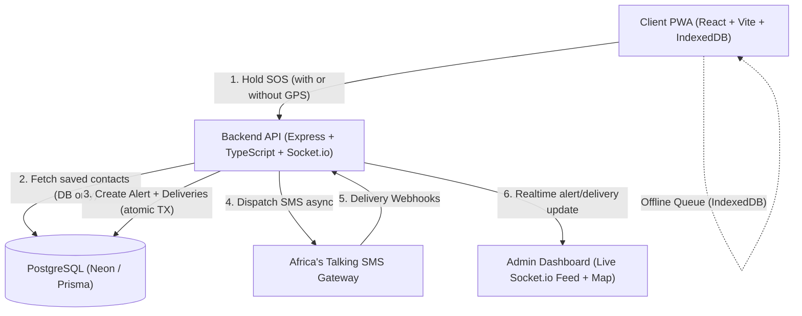

# Smart Emergency Alert System (SEAS) — Build Plan

## Architecture & System Design Narrative

### Context & Purpose
Final-year engineering project (Zetech University) engineered to production standards for the Kenyan market. Built for resilience during emergencies under intermittent connectivity, uncertain GPS conditions, and carrier delivery delays.

### Core Architecture


### Alert Lifecycle Model
1. **SOS Trigger**: Initiated client-side (hold-to-confirm ~1.5s). Idempotency key generated.
2. **Alert Persisted (`Alert.status = CREATED`)**:
   - Stored in database inside a single atomic transaction.
   - Contact list snapshotted from `EmergencyContact` database table (never client payload).
   - If user has 0 contacts, returns clear 400 validation error.
   - `locationAvailable: false` accepted gracefully if geolocation fails.
3. **Delivery Processing (`Alert.status = PROCESSING`)**:
   - Each recipient gets an independent `AlertDelivery` record.
   - State machine per delivery: `PENDING` -> `SENT` -> `DELIVERED` | `FAILED`.
   - Provider webhooks processed idempotently; terminal states (`DELIVERED`/`FAILED`) are never overwritten.
4. **Alert Completed (`Alert.status = COMPLETED`)**:
   - Once all deliveries reach a terminal state, Alert status becomes `COMPLETED`.
   - Reflects attempts completed, independent of whether SMS reached handset.
5. **Resolution Status**:
   - Tracked independently: `OPEN` -> `RESOLVED` | `CANCELLED`.
   - Cancellation restricted to user within short time window or admin.

### Directory Structure
```
emergencyapp/
├── BUILD_PLAN.md
├── BUILD_PROMPT.md
├── shared/
│   └── src/
│       ├── types.ts
│       └── dtos.ts
├── backend/
│   ├── prisma/
│   │   └── schema.prisma
│   ├── src/
│   │   ├── config/
│   │   ├── middleware/
│   │   ├── modules/
│   │   │   ├── auth/
│   │   │   ├── contacts/
│   │   │   ├── alerts/
│   │   │   ├── admin/
│   │   │   └── webhooks/
│   │   ├── services/
│   │   │   ├── sms.ts
│   │   │   └── socket.ts
│   │   ├── utils/
│   │   └── app.ts
│   ├── tests/
│   └── package.json
└── frontend/
    ├── src/
    │   ├── components/
    │   ├── pages/
    │   ├── hooks/
    │   ├── services/
    │   │   ├── offlineQueue.ts
    │   │   └── api.ts
    │   └── App.tsx
    ├── public/
    │   ├── manifest.json
    │   └── sw.js
    └── package.json
```
